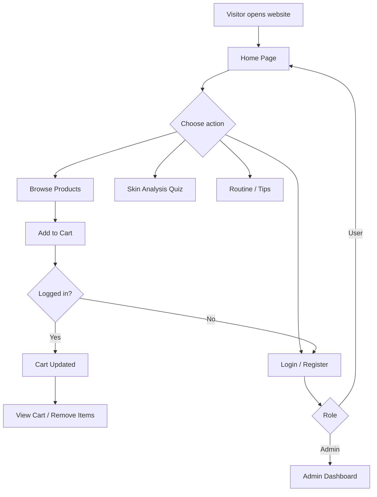
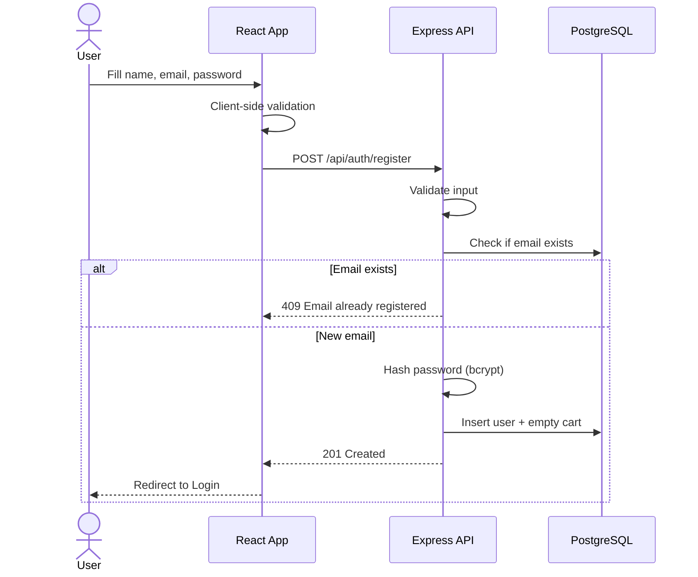
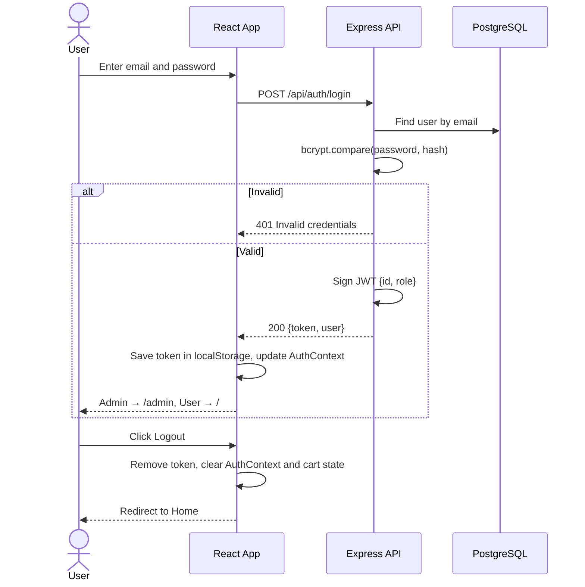
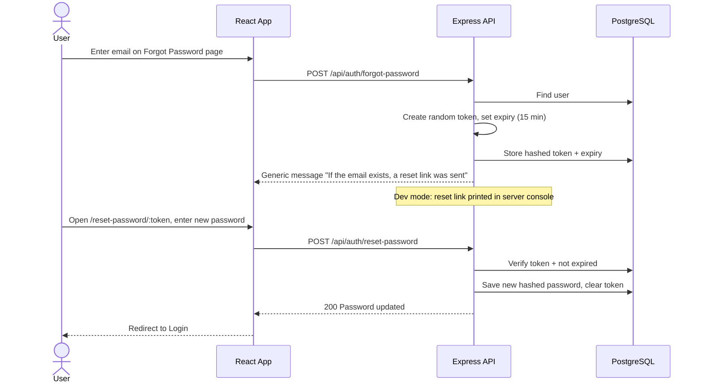
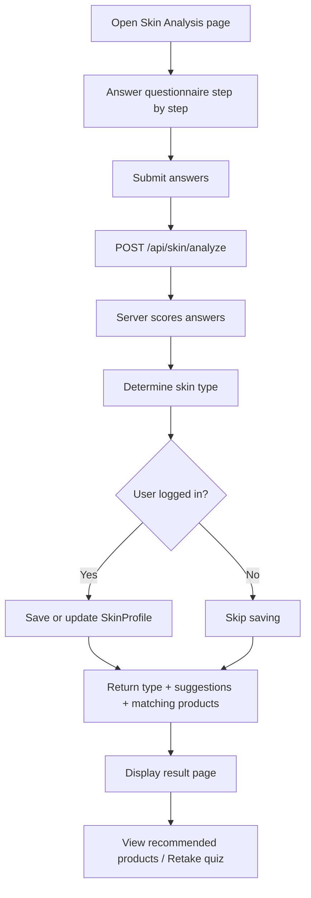
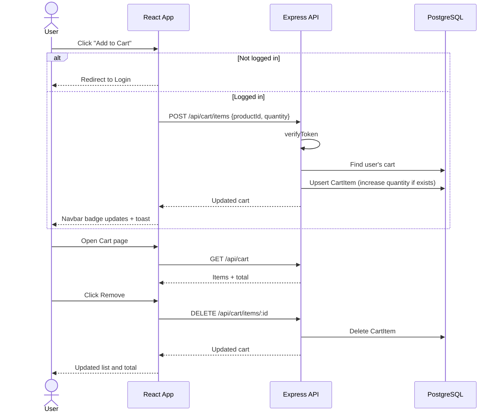
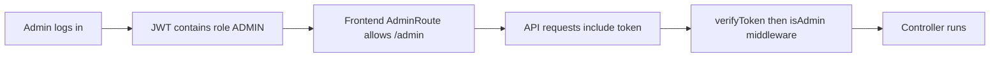
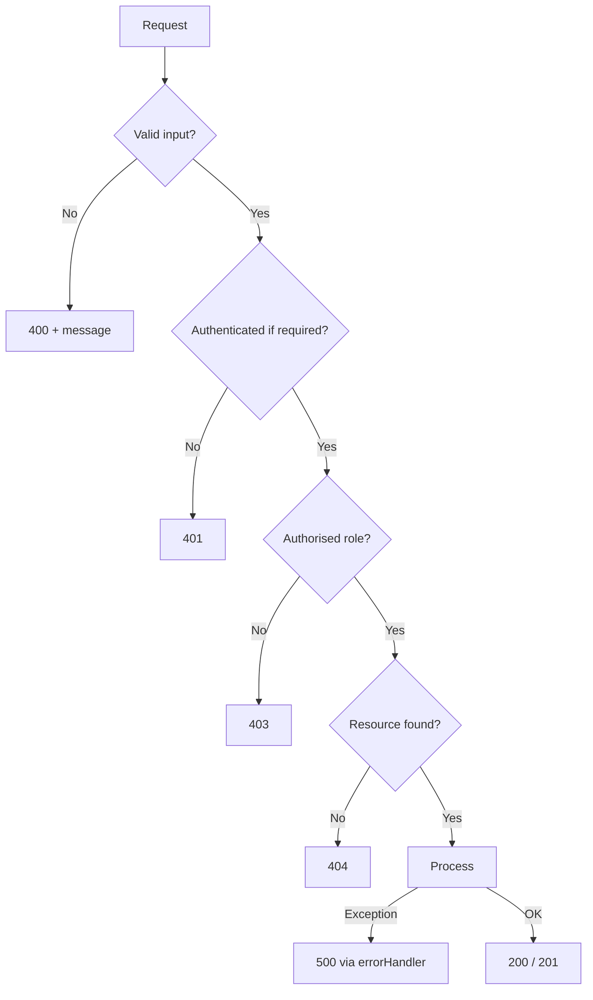
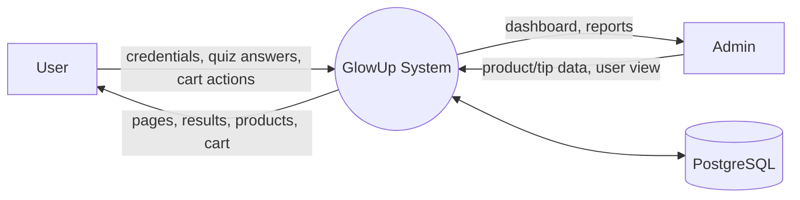

# System Workflow
## GlowUp – Beauty & Skincare Website

---

## 1. Overall Application Flow

---

## 2. User Registration Workflow

**Steps**
1. User opens the Register page and enters details.
2. React checks required fields, email format and password length.
3. API validates again, checks for duplicate email.
4. Password is hashed and the user (role `USER`) and cart are created.
5. User is redirected to login with a success message.

---

## 3. Login and Logout Workflow

---

## 4. Forgot Password Workflow

---

## 5. Skin Analysis Workflow

**Result page shows:** skin type, short explanation, do's and don'ts, ingredient suggestions, and recommended products filtered by `skinType`.

---

## 6. Product Browsing and Search Workflow

1. User opens `/products`.
2. React calls `GET /api/products` (and `GET /api/categories` for filter tabs).
3. User clicks a category tab → `GET /api/products?category=Serum`.
4. User types in search bar → debounced `GET /api/products?search=vitamin`.
5. API builds a Prisma query with `contains` (case-insensitive) on name and description.
6. Results render as product cards (image, name, description, price, Add to Cart).

---

## 7. Shopping Cart Workflow

---

## 8. Admin Workflows

### 8.1 Admin Access

### 8.2 Product Management
| Action | Flow |
|---|---|
| Add | Admin fills form → `POST /api/products` → validated → saved → table refreshes |
| Edit | Click Edit → form pre-filled → `PUT /api/products/:id` → table refreshes |
| Delete | Click Delete → confirm modal → `DELETE /api/products/:id` → row removed |

### 8.3 Beauty Tip Management
Same pattern as products using `/api/tips`.

### 8.4 View Users
Admin opens Users page → `GET /api/users` → table of name, email, role, joined date (passwords never returned).

---

## 9. Daily Routine and Tips Workflow
- Routine page is mostly static content with Morning and Night tabs; optional personalisation: if the user has a saved skin type, the page highlights suitable products.
- Tips page calls `GET /api/tips`, supports category filter (Makeup, Haircare, Natural Skincare, Articles) and opens a detail page via `GET /api/tips/:id`.

---

## 10. Error Handling Workflow

Frontend: Axios interceptor catches `401` → clears token → redirects to login; other errors show an alert message.

---

## 11. Data Flow Summary (Level 0 DFD)

