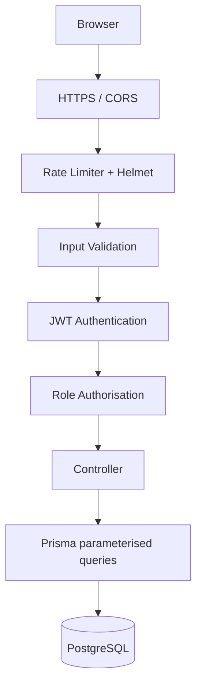

# Security Architecture
## GlowUp – Beauty & Skincare Website

This document lists practical security measures suitable for a college-level project.

---

## 1. Security Goals

| Goal | Meaning in this project |
|---|---|
| Confidentiality | Passwords and personal data are protected |
| Integrity | Only authorised users can change products, tips and carts |
| Availability | Basic protection against abuse and crashes |
| Accountability | Errors are logged on the server |

---

## 2. Security Layers



---

## 3. Authentication

### 3.1 Password Handling
- Passwords hashed with **bcrypt** (10–12 salt rounds). Plain text is never stored or logged.
- Password policy: minimum 8 characters, at least 1 letter and 1 number.

```js
const hash = await bcrypt.hash(password, 10);
const ok = await bcrypt.compare(password, user.password);
```

### 3.2 JSON Web Tokens (JWT)
- Token payload: `{ id, role }`, signed with `JWT_SECRET`, expires in 7 days.
- Sent in header: `Authorization: Bearer <token>`.
- Server verifies the signature and expiry on every protected route.

```js
// middleware/auth.js
const jwt = require('jsonwebtoken');
module.exports = (req, res, next) => {
  const header = req.headers.authorization;
  if (!header?.startsWith('Bearer '))
    return res.status(401).json({ success: false, message: 'Not authenticated' });
  try {
    req.user = jwt.verify(header.split(' ')[1], process.env.JWT_SECRET);
    next();
  } catch {
    res.status(401).json({ success: false, message: 'Invalid or expired token' });
  }
};
```

### 3.3 Forgot Password Security
- Reset token is random (`crypto.randomBytes(32)`), stored **hashed**, valid 15 minutes, single use.
- Response is always generic so attackers cannot discover which emails are registered.

---

## 4. Authorisation (Role-Based Access Control)

| Resource | Guest | User | Admin |
|---|:-:|:-:|:-:|
| View products, tips, routines | ✔ | ✔ | ✔ |
| Skin quiz | ✔ | ✔ (saved) | ✔ |
| Cart | ✘ | ✔ (own only) | ✔ (own only) |
| Profile | ✘ | ✔ (own only) | ✔ |
| View all users | ✘ | ✘ | ✔ |
| Product / tip CRUD | ✘ | ✘ | ✔ |

```js
// middleware/isAdmin.js
module.exports = (req, res, next) => {
  if (req.user?.role !== 'ADMIN')
    return res.status(403).json({ success: false, message: 'Admin access only' });
  next();
};
```

**Important rules**
- Role is read from the verified token/database, never from the request body.
- Cart queries always use `req.user.id` so users cannot access another user's cart (prevents IDOR).
- Frontend route guards (`ProtectedRoute`, `AdminRoute`) are for convenience only; real protection is on the API.

---

## 5. Input Validation and Sanitisation

Use **express-validator** (or Joi) on every write endpoint.

| Field | Rule |
|---|---|
| name | required, 2–50 chars, trimmed |
| email | valid email, normalised to lowercase |
| password | min 8 chars, letter + number |
| price | number > 0 |
| quantity | integer 1–10 |
| imageUrl | valid URL |
| IDs in URL | integer |

```js
const { body, validationResult } = require('express-validator');
exports.registerRules = [
  body('name').trim().isLength({ min: 2, max: 50 }),
  body('email').isEmail().normalizeEmail(),
  body('password').isLength({ min: 8 }).matches(/\d/).matches(/[A-Za-z]/),
];
exports.validate = (req, res, next) => {
  const errors = validationResult(req);
  if (!errors.isEmpty())
    return res.status(400).json({ success: false, message: errors.array()[0].msg });
  next();
};
```

---

## 6. Threats and Mitigations (OWASP Top 10 Mapping)

| Threat | Risk | Mitigation |
|---|---|---|
| SQL Injection | Data theft/modification | Prisma ORM uses parameterised queries; no raw string-built SQL |
| XSS (Cross-Site Scripting) | Script runs in user's browser | React escapes output by default; avoid `dangerouslySetInnerHTML`; validate tip content; Helmet CSP headers |
| Broken Authentication | Account takeover | bcrypt, JWT expiry, rate limit on login |
| Broken Access Control | Users access admin or others' data | Role middleware, ownership checks |
| Sensitive Data Exposure | Password leak | Never return `password`/`resetToken` fields (use Prisma `select`); `.env` not committed |
| Brute Force | Password guessing | `express-rate-limit` on `/auth/*` (e.g., 10 requests / 15 min) |
| CSRF | Unwanted actions | Token sent in Authorization header (not cookie), so classic CSRF does not apply; strict CORS |
| Security Misconfiguration | Info leakage | Helmet, hide `X-Powered-By`, generic 500 messages in production |
| Vulnerable Dependencies | Known exploits | Run `npm audit` before submission |
| Mass Assignment | User sets own role | Whitelist fields explicitly in controllers |

---

## 7. Backend Security Configuration

```js
const express = require('express');
const helmet = require('helmet');
const cors = require('cors');
const rateLimit = require('express-rate-limit');

const app = express();
app.disable('x-powered-by');
app.use(helmet());
app.use(cors({ origin: process.env.CLIENT_URL, credentials: true }));
app.use(express.json({ limit: '10kb' }));

app.use('/api/auth', rateLimit({
  windowMs: 15 * 60 * 1000,
  max: 20,
  message: { success: false, message: 'Too many attempts, try again later' },
}));
```

### Safe User Responses
```js
const safeUser = { id: true, name: true, email: true, phone: true, role: true, createdAt: true };
const user = await prisma.user.findUnique({ where: { id }, select: safeUser });
```

### Central Error Handler
```js
module.exports = (err, req, res, next) => {
  console.error(err);
  res.status(err.status || 500).json({
    success: false,
    message: process.env.NODE_ENV === 'production' ? 'Something went wrong' : err.message,
  });
};
```

---

## 8. Frontend Security
- Store the JWT in `localStorage` (acceptable for a college project). Note: a production system would prefer `HttpOnly` cookies to reduce XSS token theft.
- Axios interceptor adds token and auto-logs out on `401`.
- Hide admin links unless `user.role === 'ADMIN'`.
- Never put secrets in the React code; only `VITE_API_URL` is public.
- Do not render raw HTML from the database.

---

## 9. Database Security
- Use a dedicated DB user with a strong password instead of the default superuser for deployment.
- Credentials only in `.env`; add `.env` to `.gitignore`.
- Foreign keys with `onDelete: Cascade` keep data consistent.
- `email` has a unique constraint.
- Take a backup before demos: `pg_dump glowup > backup.sql`.

---

## 10. Secret Management

| Item | Practice |
|---|---|
| `JWT_SECRET` | Long random string (32+ chars) |
| `DATABASE_URL` | In `.env` only |
| Git | `.gitignore` contains `.env` and `node_modules` |
| Sample admin password | Change after first login; mention in report that it is for demo only |

Generate a secret:
```bash
node -e "console.log(require('crypto').randomBytes(48).toString('hex'))"
```

---

## 11. Logging and Monitoring
- `morgan('dev')` logs each request.
- Failed logins and server errors are logged to the console.
- Never log passwords, tokens or full request bodies for auth routes.

---

## 12. Security Checklist

- [ ] Passwords hashed with bcrypt
- [ ] JWT verified on protected routes
- [ ] Admin routes protected by `isAdmin`
- [ ] Cart and profile limited to the owner
- [ ] Validation on all POST/PUT routes
- [ ] Helmet, CORS and rate limiting enabled
- [ ] `password` and `resetToken` never returned
- [ ] `.env` excluded from Git
- [ ] `npm audit` reviewed
- [ ] HTTPS used if deployed (Render, Railway, Vercel provide it automatically)

---

## 13. Known Limitations (for the project report)
- Payment is not implemented, so no card data is handled.
- Password reset delivers the link via console instead of a real email service (Nodemailer can be added).
- `localStorage` token storage is simpler but less secure than HttpOnly cookies.
- No two-factor authentication or account lockout.
